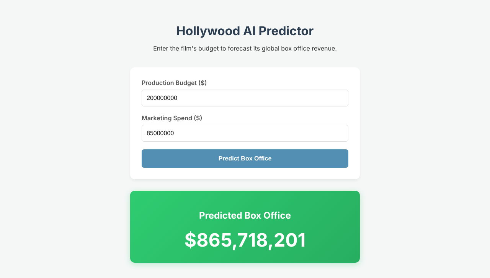

# Hollywood AI Predictor

A small end-to-end machine learning web app that forecasts a movie's global box office revenue from its **production budget** and **marketing spend**.



## How it works

| Layer | File / folder | What it does |
|-------|---------------|--------------|
| Model | `main.py`, `box_office_predictor.keras` | `main.py` trains a Keras neural network on a historical movie dataset and saves it. The `.keras` file is the trained model. |
| Backend | `app.py` | Flask API. Loads the saved model and serves predictions at `POST /predict`. |
| Frontend | `frontend/` | React + Vite UI. Sends the budget and marketing spend to the API and shows the predicted revenue. |

**Built with:** Python, Keras / TensorFlow, Flask, React, Vite.

## Run it

You need Python 3.10+ and Node.js 18+.

**1. Start the backend** (port 5000)

```bash
pip install -r requirements.txt
python app.py
```

**2. Start the frontend** (in a second terminal)

```bash
cd frontend
npm install
npm run dev
```

Open the URL Vite prints (usually http://localhost:5173), enter a budget and marketing spend in dollars, and press **Predict Box Office**.

## API

`POST http://127.0.0.1:5000/predict`

```json
{ "budget": 200000000, "marketing": 85000000 }
```

Response:

```json
{ "status": "success", "predicted_revenue": 865718200.68 }
```

On bad input the API returns `{ "status": "error", "message": "..." }`.

## Project structure

```
.
├── app.py                      # Flask prediction API
├── main.py                     # Model training script
├── box_office_predictor.keras  # Trained model
├── requirements.txt            # Python dependencies
├── docs/screenshot.png
└── frontend/                   # React + Vite app
    └── src/
        ├── App.jsx
        └── App.css
```

## Retraining the model

`main.py` reads its training data from `Untitled document-Movies.csv` and uses the `ml_edu` helper package from Google's Machine Learning Crash Course. The dataset is not included in this repository, so retraining needs both of those to be provided. Running the app only needs the already-trained `box_office_predictor.keras`.

## Group members

See `group members.txt`.
